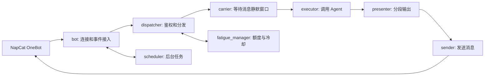

# 消息网关：连发合并与过载冷却

本页说明 `agent/net_gateway/` 的现有调用链。QQ 通道默认关闭，离线测试通过模拟事件验证合并、抢占、冷却和管理员命令；真实账号收发、语音与长时间运行需另行验收。

| 模块 | 职责 |
| --- | --- |
| `context.py` | 共享会话实例、接收时间、消息发送回调与队列状态 |
| `bot.py` | OneBot WebSocket 连接、HTTP 事件入口、启动与关闭 |
| `middleware/pipeline.py`、`security.py` | 白名单、管理命令、消息过滤与权限回复 |
| `dispatcher.py` | 组织中间件和执行任务，维护同一会话的待处理消息 |
| `carrier.py` | 记录单调时间；在静默窗口内收到更新消息时停止旧处理 |
| `executor.py` | 执行 Agent，处理中断、完成事件和用量 |
| `presenter.py`、`sender.py` | 格式转换、拆分文本、顺序发包；等待发送间隔时释放锁 |
| `fatigue_manager.py` | 按用量积累负载，触发冷却并管理恢复状态 |
| `scheduler.py` | 后台调度、空闲处理与可选语音服务检查 |
| `logger.py` | 记录活动；日志可能包含对话内容，应按私人数据处理 |

## 连发与抢占

接收消息后，`carrier.register_message()` 更新该会话的最后接收时间。处理协程等待 `QQ_CSMA_BACKOFF_SECONDS`，若期间有更新消息，旧协程退出，由较新的任务处理合并后的内容。推理期间再次收到消息时，执行器可以中断当前输出并重新处理。这个应用层机制借用了载波监听的命名，不是网络协议实现。

相关测试：`tests/test_message_merge.py`、`tests/test_gateway_simulation.py`、`tests/test_deadlock_fuse.py`。这些测试说明受测场景下的行为，不能据此推断吞吐量或所有并发时序都已覆盖。

## 过载冷却

非管理员交互的用量按 `QQ_FATIGUE_RATE` 折算为负载；到达阈值后，会话进入冷却状态。`QQ_FATIGUE_SLEEP_MINUTES` 控制冷却时长。管理员有单独的管理路径，支持“暂停私聊”“恢复私聊”和恢复指令。该机制限制连续对话消耗，不是 API 账单硬上限。

## 启用

在 `.env` 中显式设置 `QQ_ENABLED=true`、`QQ_ADMIN_ID` 和已登录的 NapCat 端点，按需配置用户及群白名单。`NAPCAT_TOKEN` 用于 OneBot 认证。默认 HTTP 事件服务只绑定回环地址；改变 `BRAIN_HOST` 前应自行配置访问控制。

前台运行：`python main.py --gateway`。`bin/`、`control/` 和 `agent/systemd/` 中保留了可选部署辅助文件，其中 launchd 模板的 `__PROJECT_ROOT__`、`__HOME__` 必须在安装前替换。本轮未安装系统服务，未执行 Docker 或 QQ 登录。
